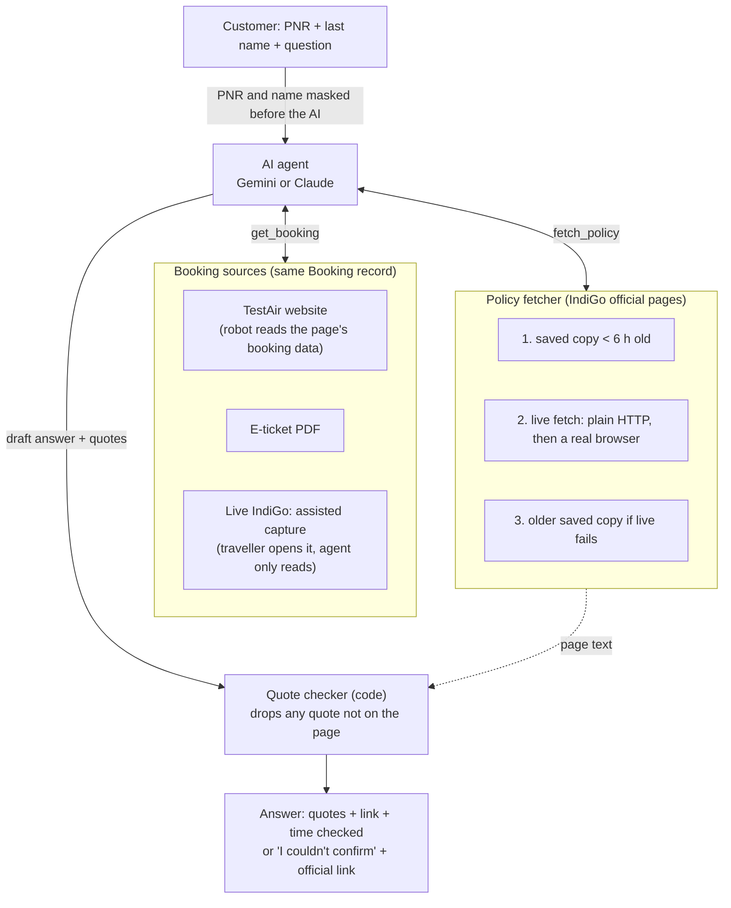
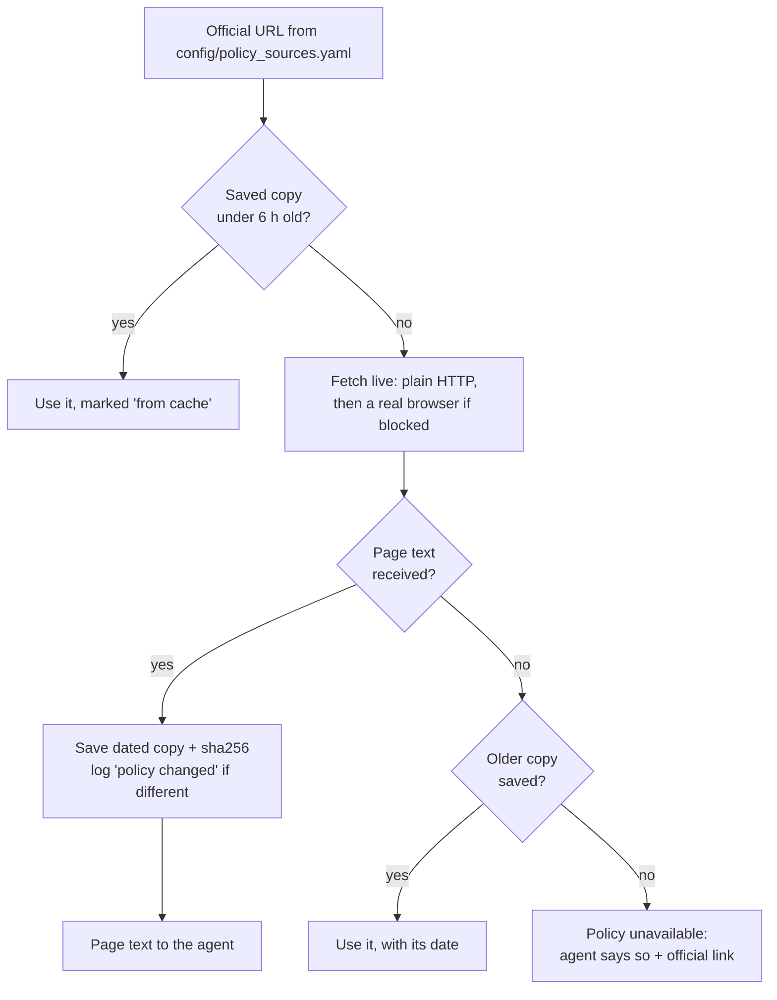

# AskMyBooking: a live airline-policy agent

**Ask a policy question about *your* booking. Get an answer built from the airline's *current* policy page,
with word-for-word quotes, the link, and the time it was checked.**

> **You:** How much check-in baggage can I take? *(PNR + last name entered separately)*
>
> **Agent:** reads the booking (Goa → Bengaluru, Saver fare, 5 kg extra bought), fetches IndiGo's baggage page,
> and answers: *"Your total check-in baggage allowance is 20 kg: 15 kg free + the 5 kg you bought."*
> It quotes *"15kg allowance per person effective Oct 1st, 2020"* from the page, gives the link, and adds:
> *"Booking read from: TestAir website. Policy fetched live at 18 Oct 2026 14:41 UTC."*

## Why this exists

This started as a document-RAG chatbot that answered from saved airline policy PDFs. A recruiter challenged it:

> *"Instead of answering from policy documents, can your agent go to the airline website (based on PNR +
> ticket details) and answer with the latest information?"*

That challenge targets two real problems:

| Problem | Example | What AskMyBooking does |
|---|---|---|
| **Generic answers** | "Check-in baggage is 15 kg" is wrong for an infant (none), a Dubai flight (30 kg), or someone who bought 5 kg extra (20 kg) | Reads the booking and applies the rule for that route, fare, passenger type and add-on |
| **Stale answers** | A fee changes; a saved PDF silently goes out of date | Fetches the official page live, timestamps the answer, and says so when it used a saved copy |

**Scope (v1):** IndiGo policies; baggage allowance, cancellation/change fees (incl. the 48-hour free-cancellation
"Look-in" rule), and the web check-in window.

## How it works



Rules enforced **in code**, not only in the prompt:

- The AI answers only from the fetched page and the booking, never from its memory of airline rules.
- Every quote must appear word for word in a fetched page. Unverified quotes are dropped and confidence is lowered;
  if none remain, the answer becomes *"couldn't confirm"* with the official link.
- Provenance (`source_urls`, `checked_at`, `policy_from_cache`, `booking_source`) is filled in from the tools,
  never written by the model.
- Time arithmetic for the 48-hour rule (hours since booking, days to departure) is computed in code.

### Fetching the latest policy



## What the recruiter suggested vs what was possible

Fetching IndiGo's **policy pages** works as suggested. Having a robot type a PNR into IndiGo's **booking page**
does not, because IndiGo deliberately blocks it. Findings from 18 Oct 2026:

| What we tried on goindigo.in | What happened |
|---|---|
| Plain program (Python httpx, curl) | No reply; the connection hangs until timeout |
| Hidden (headless) browser | Error page: "Something went wrong" |
| Normal visible browser, policy pages | Works, one page per browser session |
| Normal visible browser, Manage Booking (`/edit-booking.html`) | HTML loads, but the CDN refuses the site's own JS/CSS (`ERR_HTTP2_PROTOCOL_ERROR` on `clientlib-site.min.js`), so the PNR form never appears |

Getting past that would need stealth browsers, fingerprint spoofing or CAPTCHA solvers, which this project
deliberately does not use. Instead:

| Recruiter's idea | Why not as-is | What we built |
|---|---|---|
| Agent logs into IndiGo with the PNR | Booking pages block automated browsers | **Assisted capture:** the traveller opens their own booking in their normal Chrome; the agent attaches and only reads the booking data (never types, clicks or submits) |
| Test with real bookings | Other people's PNRs are private | **TestAir:** a fictional airline with 45 test bookings, judged against IndiGo's real live rules (*fake bookings, real rules*) |
| Always read from the website | Sites change and block | **E-ticket PDF** reader as a fallback |
| Always use the latest policy | Live fetches fail | **Honest cache:** use the last saved copy and say so, with its date |

Real travel products get bookings from airline APIs or a GDS (Amadeus, Sabre, NDC). Here, an API would simply be
one more booking source; the agent, checks and evaluation stay the same.

## Quick start (Windows / PowerShell)

Requires Python 3.11+ (developed on 3.14) and a free [Gemini API key](https://aistudio.google.com/apikey)
(or an Anthropic key).

```powershell
git clone https://github.com/Arun-2010/askmybooking.git
cd askmybooking
py -m venv .venv
.\.venv\Scripts\python -m pip install -e ".[dev]"
.\.venv\Scripts\python -m playwright install chromium

copy .env.example .env          # then open .env and paste your key after GEMINI_API_KEY=
.\.venv\Scripts\python scripts\check_llm.py                       # should end with "LLM check passed."

.\.venv\Scripts\python -m uvicorn mock_site.app:app --port 8001    # terminal 1: TestAir test airline
.\.venv\Scripts\python -m streamlit run ui\app.py                  # terminal 2: demo app → http://localhost:8501
```

In the demo app, pick a test booking in the sidebar (e.g. **TA033**, booked ~20 hours ago), choose a question,
and press **Ask**. Try a failure switch (CAPTCHA, server error, redesigned page) to see the agent stop or recover
honestly.

### Configuration and secrets

All settings live in `.env`, created from [`.env.example`](.env.example). **`.env` is git-ignored and must never be
committed.**

| Variable | Purpose | Default |
|---|---|---|
| `GEMINI_API_KEY` | Gemini key (**secret**) | — |
| `ANTHROPIC_API_KEY` | Claude key, if you use Claude instead (**secret**) | — |
| `AGENT_PROVIDER` | `gemini` or `anthropic` (auto-detected from the key present if empty) | auto |
| `GEMINI_MODEL` / `AGENT_MODEL` | Model for Gemini / Claude | `gemini-3.8-flash` / `claude-opus-5-5` |
| `GEMINI_MIN_INTERVAL_S` | Gap between Gemini requests (free-tier friendly) | `7` |
| `POLICY_CACHE_TTL_HOURS` | How long a saved policy copy is reused | `6` |
| `POLICY_MIN_INTERVAL_S` | Gap between requests to the airline site | `8` |
| `TESTAIR_BASE_URL` | Where the TestAir site runs | `http://127.0.0.1:8001` |
| `LIVE_INDIGO_MODE` | `attach` (assisted capture) or `auto` | `attach` |

Also never committed (see [`.gitignore`](.gitignore)): the virtualenv, the policy snapshot database (`data/`),
the browser profile used for live IndiGo (`.browser_profile/`, contains cookies), generated e-ticket PDFs, and any
live booking capture that isn't a `*.redacted.json` file.

### Commands

| Command | What it does |
|---|---|
| `pytest` | Unit tests (no network, no AI calls) |
| `pytest -m browser` | Playwright tests against TestAir, incl. assisted capture (starts the site itself) |
| `python -m airline_agent.agent.run "question" --pnr … --last-name …` | Ask from the command line |
| `python eval/run_eval.py` | Booking-extraction and failure-handling metrics |
| `python eval/run_eval.py --llm --answers-only --resume` | 44-question answer evaluation (resumable; safe on flaky networks and free-tier quotas) |
| `python scripts/refresh_policies.py [--pin]` | Fetch all policy pages live; `--pin` freezes them for the eval |
| `python scripts/feasibility_check.py [--pause]` | Phase 0: can IndiGo's Manage Booking page be automated? |
| `scripts\start_chrome_for_capture.ps1` + `python scripts/capture_live_booking.py` | Assisted capture of **your own** IndiGo booking (redacted before saving) |
| `python mock_site/generate_seed.py` / `python scripts/make_test_etickets.py` | Regenerate test bookings / test e-tickets |

## Testing and results

**TestAir** is a fictional airline (own name and design, no real-airline branding) with 45 bookings covering
infants, children, extra baggage, connecting and international flights, business class, cancelled and agent
bookings, and bookings made 5–60 hours ago for the 48-hour rule. Booking times are stored relative ("20 hours
ago"), so these cases stay valid on any date.

| Measured | Result |
|---|---|
| Booking read from the TestAir website (Playwright, network capture) | **100%** of fields, 45/45 bookings |
| Booking read from e-ticket PDFs | **100%** of fields, 45/45 |
| Failure switches (CAPTCHA, server crash, redesigned page, slow site, wrong PNR) | **5/5** handled correctly |
| Live IndiGo policy fetch | 4/4 official pages |
| First real AI answers (Gemini) | Correct, every quote verified on the page (20 kg baggage; free cancellation within the 48-hour window) |
| Automated tests | 51 unit + 11 browser tests passing |
| 44-question answer accuracy | In progress on the free Gemini tier (20 requests/day per model); see [`eval/results/`](eval/results/) |

The 44 questions ([`eval/cases.yaml`](eval/cases.yaml)) are 17 baggage, 13 cancellation, 9 web check-in and
5 failure cases. Expected answers were written against frozen copies of IndiGo's pages
([`eval/fixtures/snapshots.json`](eval/fixtures/snapshots.json)), so they stay valid after the live pages change.
About a quarter test honesty: the right answer is *"I couldn't confirm this"*, e.g. a fare the page doesn't cover,
or a codeshare fee table that looks relevant but isn't.

## Privacy and respect for the sites

- Raw PNRs and passenger names are never logged, stored, or sent to the AI: `get_booking` takes no arguments,
  names are dropped when a booking is read, and a logging filter masks anything PNR-shaped.
- Live captures are redacted (names, emails, phones, dates of birth) and refused if the PNR or name survives.
- No CAPTCHA solving or bypassing: the agent stops and hands control to a person.
- Low volume: verified official URLs only, robots.txt honoured, ≥ 8 s between requests, 6-hour cache, live booking
  access only for your own bookings, never PNRs found online.

## Limitations and next steps

- Live IndiGo bookings need the traveller in the loop; the IndiGo booking field mapping is completed from the first
  redacted capture of the developer's own trip.
- IndiGo's fetched pages don't cover everything (its own domestic fee table, Lite/business fares); the agent says
  "couldn't confirm" rather than guessing.
- Policy fetching opens a visible browser because IndiGo blocks hidden ones (rare, thanks to the cache).
- Next: complete the 44-question run on a paid or multi-model quota, and add a "book a ticket" flow to TestAir for
  live demos.

## Project layout

```
config/            verified policy URLs · fare mapping (TestAir → IndiGo) · page selectors
src/airline_agent/
  schemas.py       Booking, PolicySnapshot, AgentAnswer (pydantic)
  privacy.py       PNR/name masking, capture redaction
  policy/          live fetcher + SQLite snapshot store (TTL cache, sha256 change log)
  booking/         TestAir (Playwright), e-ticket (pdfplumber), live IndiGo (assisted capture)
  agent/           tools, prompt, quote checker, Gemini + Claude loops
mock_site/         TestAir: FastAPI app, templates, 45 seed bookings, failure switches
eval/              44 cases, frozen IndiGo pages, resumable runner, reports
ui/app.py          Streamlit demo with live progress steps
scripts/           feasibility check, policy refresh, Chrome capture helpers, model check
tests/             unit + browser tests
```

**Stack:** Python · Gemini (`google-genai`) / Claude (`anthropic`) · Playwright · httpx · trafilatura ·
FastAPI · Pydantic · SQLite · pdfplumber · Streamlit · pytest
